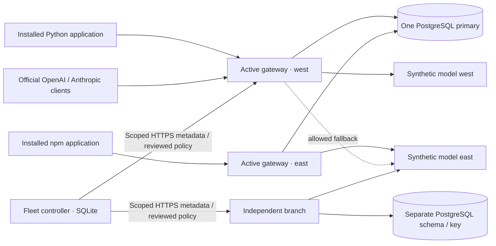

# Synthetic customer acceptance

[← Pliqra](../README.md)

This is a **scripted synthetic customer exercise**, not a customer reference, usability study or external protocol certification. It provides repeatable evidence before a real pilot is available. No paid vendor inference, customer records or existing user workspace is used.

## Scenario and topology

A fictional organization connects model endpoints, publishes a shared AI service, binds an application, uses both native client APIs and governs an independent branch installation.



All containers run on **one physical host**. Site/region names are synthetic. Gateway/member and PostgreSQL connections verify a disposable CA and certificate hostnames; TLS verification is never disabled. The controller console is loopback HTTP. Two active gateways share the root workspace's database authority; the branch has a separate schema and encryption key. The model fixture is a separate standard-library HTTP server and is excluded from the production image.

## Repeat locally

Requirements: Docker Compose, Python 3.13+, Node 22+ (or the optional Node Docker image), and free loopback ports 18091–18096. Start Docker first. Run in a source checkout; the generated `work/` state contains disposable fixture credentials and is ignored by Git.

```sh
python -m venv .venv
.venv/bin/python -m pip install -r requirements-dev.txt -r requirements-sdk.txt
docker build --build-arg REVISION="$(git rev-parse HEAD)" -t pliqra:rc3-acceptance .
.venv/bin/python scripts/build_sdks.py
.venv/bin/python scripts/check_sdk_install.py dist/sdk
.venv/bin/python scripts/customer_acceptance.py --state work/customer-lab \
  --load-seconds 30 --soak-seconds 600 --concurrency 8 --soak-rate 5 --keep
.venv/bin/python scripts/check_customer_clients.py work/customer-lab
# Add --docker-node to run the npm consumer in the official Node image.
python -m venv work/official-client-env
work/official-client-env/bin/python -m pip install -r requirements-acceptance.txt
work/official-client-env/bin/python tests/acceptance/official_clients.py work/customer-lab
```

Omit `--keep` to remove the disposable containers and volumes automatically at the end of the main exercise. To inspect the console, retain the lab, use the synthetic operator credentials generated in its private state, then remove only that lab:

```sh
.venv/bin/python - <<'PY'
import json, subprocess
from pathlib import Path
state=Path('work/customer-lab')
project=json.loads((state/'lab.json').read_text())['project']
assert project.startswith('pliqra-accept-')
subprocess.run(['docker','compose','--project-name',project,'--env-file',str(state/'fixture.env'),'-f','tests/acceptance/compose.yaml','down','--volumes'],check=True)
PY
```

The manually dispatched [acceptance workflow](../.github/workflows/acceptance.yml) repeats the lab, installed consumers and official clients, cleans up in an unconditional step and uploads **only the three public report files**. It never uploads the fixture environment, tokens, certificates or private keys. `--resume` can continue an interrupted, retained lab created by the same script; it is not intended for an existing customer workspace.

## Assertions

| Track | Checked behavior |
|---|---|
| Endpoint onboarding | Public setup/connection APIs, model discovery, capability/pricing configuration, named service and scoped key |
| Active sites | Local model from each site; 16 concurrent requests against a shared limit of eight produce exactly eight successes and eight HTTP 429 replies |
| Native streaming | Six provider/interface combinations deliver first text before completion; missing terminal event is an error, not fabricated success |
| Independent applications | Installed wheel runs nine core profile checks and Unicode streaming; installed npm package discovers, binds and streams without gateway imports |
| Official native clients | OpenAI Responses and Anthropic Messages libraries consume translated text/tool streams against synthetic providers; automatic retries disabled |
| Fleet | Explicit scoped pairing, duplicate shared-workspace rejection, author cannot approve, separate reviewer and per-member receipts on two independent authorities |
| Load / soak | Bounded concurrency, observed latency percentiles/statuses, throughput and sampled resident memory; deterministic fixture delay disclosed |
| Failure / recovery | Stop local model and use allowed remote fallback; stop database and confirm no new model admission; restart database and verify fenced gateway rejoins under a fresh node identity |
| Automated boundaries | SQLite/PostgreSQL fleet tests cover response loss after commit, idempotent retry, drift/CAS conflict, revocation, read-only scopes, plan expiry, rollback approval and metadata whitelisting |

The independently executable core profile also runs against the separate reference server in `tests/test_live_conformance.py`; those tests do not claim an independent third-party implementation or external adoption. See [conformance](CONFORMANCE.md).

## Observed results

Run date: **7 November 2026**. Docker Desktop on macOS ARM64, 14 configured CPUs, approximately 7.75 GiB Docker memory, PostgreSQL 18 and deterministic 5 ms non-streaming model delay. Eight concurrent clients alternated between the two active gateway sites.

| Measurement | Load | Initial soak |
|---|---:|---:|
| Duration | 30.11 seconds | 601.30 seconds |
| Successful requests | 3,032 / 3,032 | 3,000 / 3,000 |
| Observed request rate | 100.70/s | 4.99/s (target 5/s) |
| p50 / p95 / p99 | 72.74 / 92.71 / 106.94 ms | 85.40 / 99.13 / 110.94 ms |
| West gateway RSS samples | 108,436 KiB | 108,440 → 109,656 KiB |

All onboarding, exact shared-quota, fleet, native-stream and model/database interruption assertions passed. Two installed SDK applications passed; the Python application also passed all nine core profile checks. Six official-client scenarios passed with OpenAI 3.46.0 and Anthropic 2.6.0. The console exercise created a two-target policy through the form and confirmed that its author could not approve it.

[Full lab results](evidence/customer-rc3.json) · [Installed SDK applications](evidence/customer-installed-clients-rc3.json) · [Official native clients](evidence/customer-official-clients-rc3.json)

The lab image was built from the pre-commit working tree. Its immutable image ID and Python source SHA-256 are recorded; that hash identifies the measured runtime. A subsequent native accounting correction rejects missing final Anthropic output usage; its targeted parser/HTTP tests pass and the measured Chat load/soak path is unchanged. Other subsequent changes were documentation, package/repository metadata and a console reviewer-identity label. CI validates the tagged distribution separately. These short measurements use deterministic, low-latency upstreams; they cannot establish production token throughput, a capacity limit or hardware sizing.

## What remains a real-pilot responsibility

Geographic WAN partitions/latency, PostgreSQL primary promotion and durability/RPO, real model saturation/quality, actual vendor billing, customer NeMo/Vault/identity providers and real human onboarding feedback are not simulated away. Ten minutes is an initial soak, not days of endurance evidence. Gateway RSS samples are a trend for this run, not a proof of leak absence. The controller's 24-hour summaries are asynchronously collected metadata, not an exact global billing ledger. A stable-release support envelope must be chosen for the actual deployment.

## Published distribution acceptance

[RC3](https://github.com/eturkok/pliqra/releases/tag/v2.1.0-rc.3) was published from `5c7ff226faa6f5ad466c2b6b457480cb9e76cb03`. Native AMD64/ARM64 image checks passed, including non-root execution and bundled Apache LICENSE/NOTICE; anonymous image access was verified. The final tagged synthetic acceptance workflow passed after the native usage correction.

Both official registries serve SDK 0.1.0-rc.1: [PyPI](https://pypi.org/project/pliqra-client/0.1.0rc1/) and [npm](https://www.npmjs.com/package/@eturkok/pliqra/v/0.1.0-rc.1). Anonymous downloads matched the tested release hashes. Clean canonical registry installs and calls from those installed clients against the isolated synthetic gateway passed. [Registry/distribution evidence](evidence/registry-sdk-rc3.json).

PyPI publication used the configured GitHub OIDC publisher. The first npm version used the owner-authenticated bootstrap; the subsequent GitHub OIDC attempt validated the npm trust and was intentionally rejected with E403 because the exact version already existed. The npm settings showed **Valid** afterward. This negative check did not overwrite the version or add provenance to the already published bootstrap artifact. Future new npm versions use the configured workflow.

Publisher retries were subsequently improved for RC4: identical existing registry artifacts are verified and complete successfully; changed/incomplete artifacts or registry errors fail. The [successful npm/PyPI retry record](evidence/sdk-publication-retry.json) supersedes the old duplicate-upload failure as the current delivery behavior.
