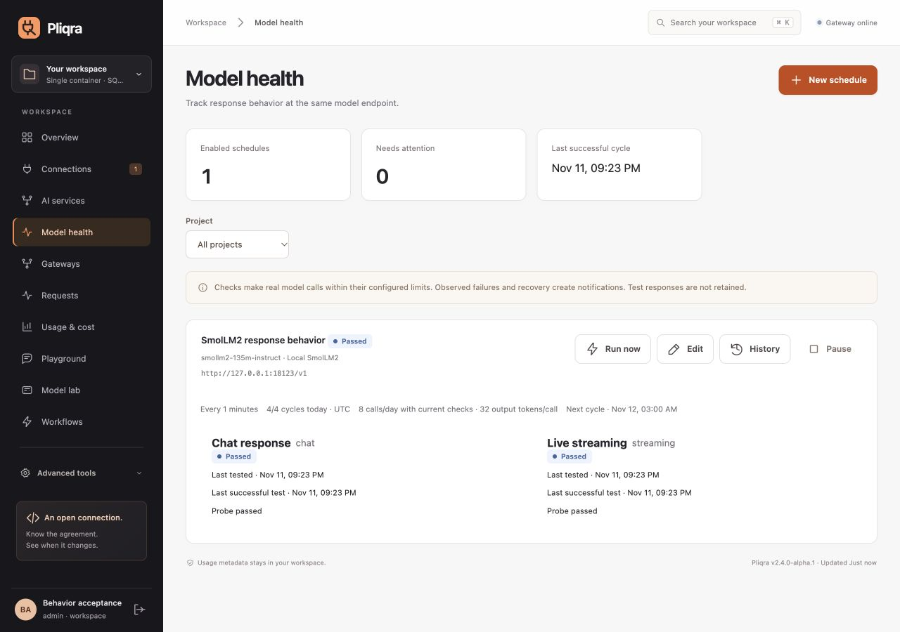

# Scheduled model behavior checks

Implemented in **2.4.0-alpha.1 source / schema 7**. The published stable Docker image remains **2.3.0**; it does not contain this feature yet.

A connection contract detects registered configuration changes. A provider can also change the model behind an unchanged URL and model name. Opt-in behavior checks repeatedly exercise selected expectations against that deployment, retaining outcomes and the last successful test. They complement contracts and release evaluations.

## Configure in the console

1. Connect the model endpoint, then open **Model health → New schedule** as an administrator.
2. Select a deployment and the project that pays for its calls. Add named expectations, choose a cadence and daily cycle limit, and save. Periodic execution is off by default.
3. Use **Run now** to establish a baseline. Inspect each result and its request accounting, then enable periodic checks when appropriate.

The overview shows schedule status and the latest successful cycle. **Model health** filters by project and shows the endpoint, next cycle, daily usage, each check's last test and last success, and its most recent outcome change. **History** retains individual cycles with links to their request records. Failure and recovery transitions also appear in **Operations → Notifications** and the audit log. Repeated identical failures do not create repeated transition notifications. An initial failure produces a notification even without a successful baseline.



## Checks and limits

| Setting | Behavior |
|---|---|
| Chat | Require non-empty text. Optionally send a custom prompt and assert a case-insensitive text fragment. |
| Streaming | Exercise Chat Completions SSE and require a complete stream without a recorded upstream/incomplete-stream error. |
| JSON Schema | Request a small structured object and check that the response is exactly `{"ok": true}`. |
| Tool calling | Require the requested `pliqra_probe` function with `value` equal to `ok`. |
| Latency | Optional maximum full-response latency for any check. This is not a first-token target. |
| Cadence | 60 seconds–7 days, measured from the last cycle's start; the worker polls every five seconds. Busy replicas can delay a cycle. |
| Daily limit | 1–288 cycles per schedule per UTC day, including manual, failed and interrupted cycles. A cycle reserves its daily slot before model IO. |
| Call limits | 1–8 named checks; 16–512 maximum output tokens per call; 5–90 seconds timeout per check. At most one cycle runs per workspace. |
| Project | Calls use normal admission, concurrency and configured project budget accounting. Unknown prices remain unknown; configure prices before relying on monetary limits. |

With four checks and a limit of 24 cycles, the current plan permits at most 96 calls/day. Editing the plan does not refund used cycles. Lowering limits does not cancel already admitted IO. Pausing or editing stops subsequent checks in an in-flight cycle; a started call can finish.

Calls target the selected deployment directly, with no cache or fallback. Check prompts/configurations are encrypted at rest. Response text is not retained by this flow; history contains assertion results, sanitized errors, timestamps and request IDs. Standard request metadata/accounting remains available separately.

## Interpret the evidence

- **Passed / assertion failed** describes the selected response expectations. **Check error** describes execution problems such as budget rejection, timeout or provider unavailability. Interrupted and superseded cycles remain separate.
- A failing check retains its prior successful timestamp. The most recent transition remains visible through subsequent identical outcomes. The cycle's last successful timestamp requires every check to pass.
- Changing the deployment, assertions, token/timeout limits or accounting project resets the current baseline. Registered endpoint/configuration changes also establish a new baseline. Historical cycles retain their version and fingerprint.
- Observations do **not** change declared/verified capabilities, model circuit/health state, routing, application bindings or publication policy. An administrator decides what action follows a notification.

These checks detect violations of the chosen expectations. They do not identify model weights, compare arbitrary response text, prove semantic equivalence or guarantee general model quality. Temperature zero reduces variability without guaranteeing deterministic output. Use representative custom prompts and [evaluations](WORKFLOWS.md) for broader task quality.

## Management API

Administrator session authentication and the existing CSRF protection apply. All routes are scoped to the current workspace:

| Method | Route | Result |
|---|---|---|
| GET | `/api/v1/behavior-checks` | Configurations, current results, last success, next run and daily counters |
| POST | `/api/v1/behavior-checks` | Create a schedule (201), paused unless explicitly enabled |
| PUT | `/api/v1/behavior-checks/{id}` | Replace the configuration and increment its version |
| POST | `/api/v1/behavior-checks/{id}/run` | Claim a cycle and return its ID (202) |
| GET | `/api/v1/behavior-checks/{id}/runs?limit=50&offset=0` | Paginated retained history, newest first |

Example POST body; replace the deployment/project IDs with local records:

```json
{
  "name": "Support response expectations",
  "deployment_id": "dep_example",
  "project_id": "default",
  "enabled": false,
  "interval_seconds": 3600,
  "max_runs_per_day": 24,
  "max_tokens": 128,
  "timeout_seconds": 30,
  "checks": [
    {"name": "Support sentinel", "capability": "chat", "prompt": "Reply with SUPPORT_READY.", "contains": "SUPPORT_READY"},
    {"name": "Tool contract", "capability": "tools"}
  ]
}
```

`Run now` also works on a paused schedule, subject to the same limits. Concurrent cycles return 409; the daily limit returns 429. There are at most 100 schedule definitions per workspace. Pause unused definitions to keep their history. The owner must remain an active administrator and is revalidated before each call; another administrator can take ownership by saving the configuration.

## Persistence and multiple sites

Schedules, daily reservations and history are stored in the workspace database. Shared PostgreSQL serializes cycle claims across replicas. A site-specific model is checked from its own active site; shared endpoints can be checked from any active site. Maintenance, standby, draining and fenced replicas admit no new check calls. This is one workspace-wide observer, not a simultaneous per-DC synthetic monitoring service.

After an interrupted process/expired replica lease, started work is marked interrupted and is not replayed. A later regular cycle can run when due; missed intervals are not queued for catch-up. Daily reservations remain spent. History/probe records follow the existing retention setting; latest per-check results stay with the schedule.

Upgrading this source migrates storage from **6 to 7**. Coordinate all writers and take a database/key backup before upgrading. Schema-6 SQLite and PostgreSQL portable archives can restore into schema 7. Restoring a backup pauses all restored schedules until an administrator reviews and re-enables them. Downgrading to stable 2.3 requires the matching pre-upgrade schema-6 backup, not opening schema 7 with an old image. See [operations](OPERATIONS.md) and [multi-DC upgrades](MULTI_DC.md#evidence-and-upgrade).

## Validation

The [real-endpoint record](evidence/behavior-checks-2.4.json) captures four successful cycles against actual SmolLM2 weights served by official llama.cpp: two manual and two automatic cycles, eight chat/streaming checks in total, an unchanged endpoint fingerprint and rejection after the daily limit. An additional custom-text check was created and run through the console; its successful result appeared without navigation. The editor, pause, history and restart persistence were exercised; layouts were checked at 320, 390 and 1280 pixels.

Separate automated tests change a tool response at the same endpoint, verify failure/recovery transitions and retained last success, reject over-budget calls, stop remaining checks after edits, distinguish timeouts/provider errors, and cover atomic claims, revoked owners and backup migration. PostgreSQL tests exercise shared claims and expired-replica interruption. The local real-model run did not change model weights or establish broad JSON/tool quality.
