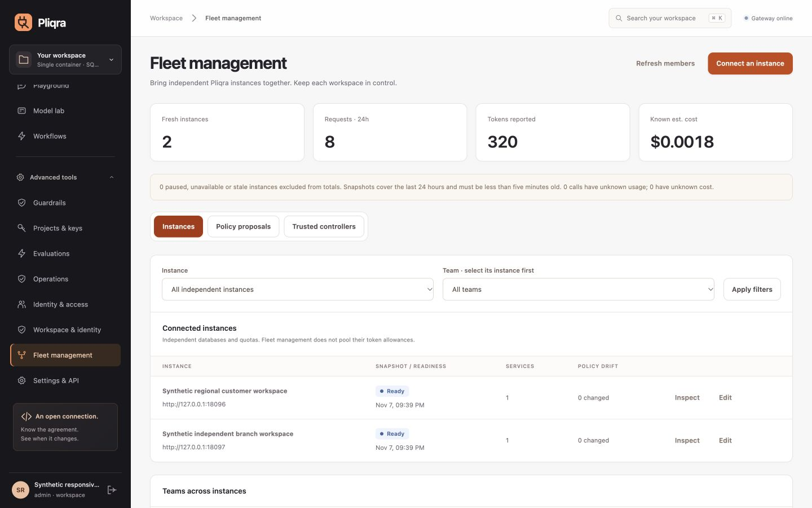
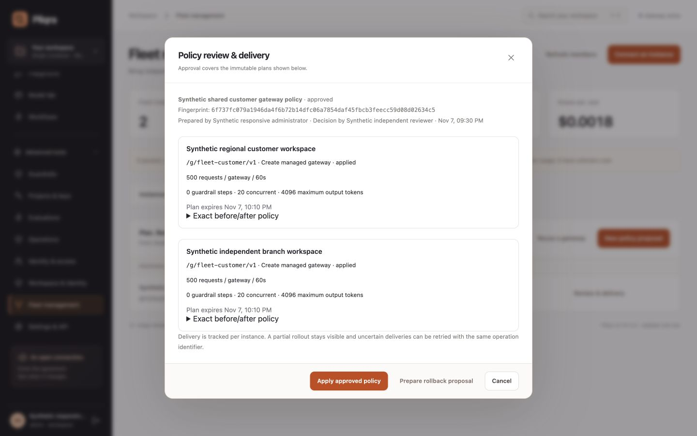

# Pliqra console tour

[← Pliqra](../README.md)

Screenshots show the real console in isolated synthetic workspaces. Credentials and private production content are excluded.

## Connect an endpoint, verify a call, connect an application

## Inspect services and requests

All screenshots come from the actual running console in an isolated demonstration workspace. Models and traffic are clearly synthetic; no production accounts, provider secrets or private prompts are shown.

### From endpoint to a stable service

### Negotiate the application's connection

### See when an application needs to reconnect

The selected service shows active application identities whose contract no longer matches. A fresh binding for the same identity clears its renewal notice. Revoked credentials, expired bindings and identities that lost access do not count as active connections. Drift detection covers service configuration and advertised model metadata; undisclosed model-weight changes behind an unchanged endpoint cannot be inferred.

### Follow the request all the way through

Team attribution and individual model attempt accounting

### Give administrators a cumulative and team-level view

### Test the endpoint before connecting your application

## Build a gateway for each workload

Pliqra now brings the model-as-a-service catalog, inference routing, identity, quotas and guardrail execution into one console. Administrators can publish separate gateways for teams or applications, each with its own address and versioned policy. Keys assigned to a gateway enforce its policy on every inference path.

- Combine request and token quotas across independent rolling windows and gateway, key, user/owner, project, team or service scopes.
- Set concurrent-request, input/output and capability controls while retaining service routing, key RPM limits and project budgets.
- Chain local checks, NVIDIA NeMo check-API providers and custom HTTP validators before inference and before output delivery. Choose enforcement or observation and an explicit failure policy per step.
- Preview admission without inference, try the gateway in the playground, issue scoped keys, inspect decisions, clone policies, export/import definitions and restore prior versions.

See [the gateway and guardrail guide](GATEWAYS.md) for configuration, APIs, architecture, quota accounting, streaming and the exact NeMo compatibility boundary. External engines remain optional services; Pliqra itself still runs in one container.

## Expanded workflows in 2.0

**Model lab** adds embedding, speech, transcription and compatible native API forms. Results link to the same detailed request evidence as Playground. **Workflows** groups batch progress/output inspection, immutable prompt publication/use, external judges and quality-gated canary controls. **Workspace & identity** groups organization boundaries, workload trust, secret references, analytics exports and vendor claim profiles. **Settings & API** supplies the language clients and executable conformance suite.

These images use a separate disposable workspace with synthetic providers and example identities; no private workspace was seeded or published. See [workflow details](WORKFLOWS.md) and [identity compatibility](IDENTITY_COMPATIBILITY.md).

## Active/active sites in 2.1

**Workspace & identity → Data centers** shows live replicas and model leases per site, with versioned active/draining/standby controls. Endpoint forms assign model locations; service policies select local preference and allowed sites/regions. Request views and reports expose gateway/model sites.

The screenshot is from the disposable local two-site acceptance environment. See [multi-DC deployment and failure semantics](MULTI_DC.md).

## Independent installations in RC3

**Advanced tools → Fleet management** brings independent Pliqra workspaces into one metadata dashboard. Filter by installation and its team, inspect freshness and drift, pair explicit controllers and prepare shared gateway policies with local resource mappings. A different administrator reviews the immutable plan; delivery and rollback stay visible per target.

These screenshots come from the isolated synthetic customer lab. [Fleet authority and API details](FLEET.md) · [Repeatable acceptance](ACCEPTANCE.md)

## Responsive console

The console adapts from compact phone screens to wide desktops. The sidebar header/account stay visible while its navigation scrolls; narrow-screen tables become labelled cards. Filters and editors stack naturally, and long dialogs keep their close/action areas reachable. [Viewport evidence and regression checklist](RESPONSIVE_UI.md).

[Phone dashboard](screenshots/responsive-fleet-mobile.png) · [Phone gateway editor](screenshots/responsive-gateway-mobile.png)
