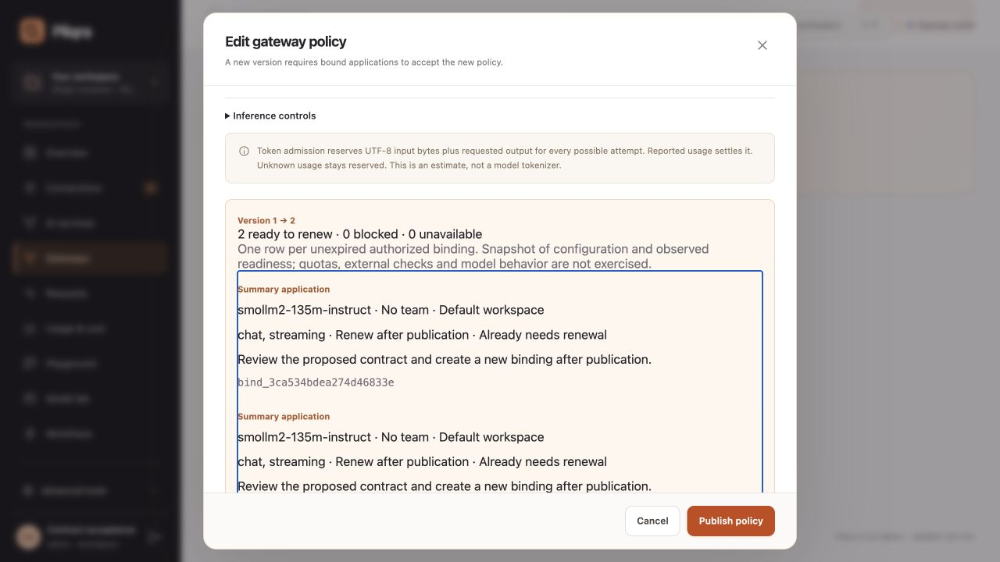

# Application impact and existing-client protection

Available in the 2.3 development source (`2.3.0-alpha.1`). Published stable Docker 2.2.2 predates these additions.

## Review before publication

Edit an AI service or gateway in the console and select **Preview changes** or **Preview impact**. Each report row represents an unexpired binding belonging to a currently authorized identity. It identifies the application key or user, attributed team/project, service, accepted requirements and binding ID.

- **Renew** means the proposed configuration currently has eligible deployments and permits the requirements. Review the new contract, publish, then explicitly bind again.
- **Blocked** means access, configuration or required capabilities prevent reconnection. Restore the required capability or grants first.
- **Unavailable** means the observed deployment health temporarily prevents reconnection. Check readiness before reconnecting.

Revoked/expired keys, expired bindings, disabled users and lost access are excluded. Multiple bindings for an application remain separate because they may accept different capabilities. Already stale contracts are labelled. For session identities without a key attribution, the report shows the service project and no attributed team.

The report evaluates configuration and observed readiness without model calls, external guardrail calls, quota reservation or content capture. It does not execute the application or guarantee future model output, capacity or budget admission. Requirements stored in the binding are assessed; past request shapes and application code are not inferred.

API entry points are administrator-only and scoped to the current workspace.

- `POST /api/v1/ports/{id}/preview` accepts the proposed service document and includes `impact`.
- `POST /api/v1/gateways/{id}/impact` accepts the proposed gateway document and returns `impact`.
- Both accept `limit` (1–200, default 100) and `offset` query parameters. Summary counts cover every included binding; `items` contains the requested page.
- `impact.summary` contains `renew`, `blocked` and `unavailable` counts. Each item includes human-readable reasons, the next action and deployment decisions.

The console sends the report's `current_fingerprint` as a quoted `If-Match` header when publishing. A conflicting service/policy change returns 409 and requires another preview. API clients can use the same optional header. Reports are snapshots; inference still applies current identity, contract and quota checks at admission. The impact report adds no approval workflow.



## Use your existing client

First use the console's **Connect application**, or `POST /protocol/v1/bindings` with your application key, to accept the service requirements. Keep the returned binding ID with the application configuration. The console supplies ready-to-copy curl, Python and JavaScript settings.

```python
import os
from openai import OpenAI

client = OpenAI(
    api_key=os.environ["PLIQRA_API_KEY"],
    base_url="http://localhost:8088/v1",
    default_headers={"X-Pliqra-Binding": os.environ["PLIQRA_BINDING_ID"]},
    max_retries=0,
)
response = client.chat.completions.create(
    model="support",
    messages=[{"role": "user", "content": "Hello"}],
)
```

```javascript
import OpenAI from "openai";

const client = new OpenAI({
  apiKey: process.env.PLIQRA_API_KEY,
  baseURL: "http://localhost:8088/v1",
  defaultHeaders: {"X-Pliqra-Binding": process.env.PLIQRA_BINDING_ID},
  maxRetries: 0,
});
const stream = await client.chat.completions.create({
  model: "support",
  messages: [{role: "user", content: "Hello"}],
  stream: true,
});
```

Use the service name as `model`. Named gateways use `/g/{slug}/v1` as the base URL. The bearer credential and binding must belong to the same identity. Service grants, assigned gateway, guardrails and quotas still apply. A binding is not a credential.

The header supports **Chat Completions only**, including streaming. Empty, malformed or duplicate headers and use on another API return 422. Missing, expired or foreign bindings return 403. Changed service/gateway/guardrail contracts return 409. Errors do not silently create another binding. Renew explicitly with the same application identity after reviewing the changed contract. Unprotected calls and existing protocol/SDK invocations remain available.

## Real endpoint evidence

The [recorded run](evidence/contracts-2.3.json) uses the official Python and JavaScript OpenAI clients against local Pliqra and an actual **SmolLM2-135M-Instruct Q4_K_M** model served by **llama.cpp b12248** on macOS ARM64 CPU. This uses real model weights and generated text.

Nine scenarios passed, including JavaScript JSON/streaming and 409 rejection: JSON, incremental streaming, a named gateway, a missing-streaming publication report without inference, 409 before model execution, explicit renewal and restored inference, and a policy report showing access loss. The incompatible candidate is deliberately configured with chat-only declared capabilities. This tests the contract/configuration decision; it does not claim that this model lacks streaming or establish its general tool quality.

Reproduce against a fresh disposable Pliqra workspace and an OpenAI-compatible real model endpoint. Install the official client dependencies used by `tests/acceptance/official_clients.py`, then run:

```sh
python tests/acceptance/contracts_live.py \
  --gateway http://127.0.0.1:18124 \
  --endpoint http://127.0.0.1:18123/v1 \
  --model smollm2-135m-instruct \
  --runtime-label "llama.cpp b12248 (CPU)" \
  --javascript-modules /absolute/path/to/client-env/node_modules \
  --node /absolute/path/to/node \
  --report contracts-live.json
```

The script refuses setup on an initialized workspace. Credentials are generated in memory; reports contain no credentials or model text. Automated regressions additionally exercise revoked identities, expired bindings, malformed/duplicate headers, wrong interfaces, gateway quotas, guardrail changes, pagination and conflicting publication.
