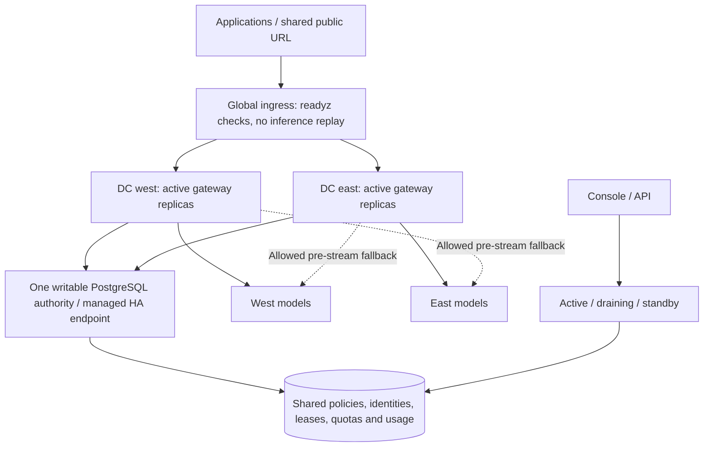

# Active/active data centers

Pliqra 2.1 supports gateways in multiple data centers with **one shared writable PostgreSQL authority** and exact shared request/token admission. Each gateway knows its site and region, prefers local models when requested, and stops admitting work if it loses the authority. The default single-container SQLite installation remains available.

## Supported topology



This is active/active **gateway** deployment. Database replication, leader election, fencing the former primary and global ingress are supplied by your infrastructure. Two independently writable databases do not form one Pliqra cluster. PostgreSQL advisory locks cannot coordinate independent primaries.

## Deploy each site

Use [compose.multidc.yaml](../compose.multidc.yaml) separately on each host/DC. Its image is the same platform-independent application. Prepare a private configuration directory readable by UID 10001 containing:

- `master.key`: the same Fernet master key at every site; preserve the existing key when adding sites to an existing installation.
- `db-ca.pem`: the CA for your PostgreSQL endpoint. Add client certificate/key files here if your database requires mutual TLS.

Set the deployment variables, for example in an uncommitted `.env.multidc`:

```dotenv
PLIQRA_SITE=dc-west
PLIQRA_REGION=eu
PLIQRA_PUBLIC_URL=https://models.example.com
PLIQRA_DATABASE_URL=host=db-a.example.com,db-b.example.com port=5432 dbname=pliqra user=pliqra password=YOUR_DATABASE_PASSWORD sslmode=verify-full sslrootcert=/run/pliqra/db-ca.pem target_session_attrs=read-write
PLIQRA_CONFIG_DIR=/absolute/path/to/private-config
```

Use a secret injection mechanism for the connection string in production. The example file is private deployment configuration, not a service export. Configure `dc-east` on the other host with its own site ID, the same region when applicable, and the same database/schema, key and public URL.

```sh
docker compose --env-file .env.multidc -f compose.multidc.yaml up --build -d
```

The file publishes on loopback; attach your site's trusted ingress. Route the shared HTTPS public URL across healthy site ingresses. Configure secure federation callbacks against that shared URL. Preserve response streaming, bound request sizes and disable inference retries at every proxy. Do not copy a live SQLite volume between DCs.

`PLIQRA_MULTI_DC=1` refuses SQLite and remote database connections without `sslmode=verify-full`. Explicit database addresses are required. Connections enforce `target_session_attrs=read-write`; a multi-host string can select a reachable writable server, but it does not elect or promote a primary. Keep control traffic on a private network and protect the shared key consistently across sites.

## Console and API controls

**Advanced tools → Workspace & identity → Data centers** shows each site's region, traffic mode, live replicas and active model leases. Sites register on startup, or an administrator can pre-register one using `POST /api/v1/sites`. Pre-registered sites default to standby. A running gateway must match its registered region.

Change a site with `PUT /api/v1/sites/{id}/mode`:

```json
{"mode":"draining","version":1}
```

The current version is required; stale updates return 409. All changes are audited. Site modes are workspace-scoped; each organization has an independent registry and operational controls.

| Mode | New local inference | New selection of models assigned to that site | Administration / health checks |
|---|---|---|---|
| active | Allowed while ready | Allowed by service placement | Available |
| draining | Rejected with 503 | Excluded | Available |
| standby | Rejected with 503 | Excluded | Available |

Draining lets already admitted calls finish. Queued batch items yield to an active site; started items are not replayed. Wait for active calls to reach zero before stopping a drained gateway. If every site is inactive, new inference stops: retain an operator management path or reactivate a site through the authenticated API.

## Model location and routing

Assign a registered **Model location** when connecting or editing an endpoint. Its region comes from the site registry. A shared/cloud endpoint can remain unplaced. In **AI services → Service access & policies**, configure:

```json
{
  "placement": {
    "routing": "local_first",
    "allowed_sites": ["dc-west", "dc-east"],
    "allowed_regions": ["eu"]
  }
}
```

- `local_first`: prefer this gateway's site, then shared/unplaced endpoints, then other allowed sites. Service priority/round-robin order applies within those groups.
- `local_only`: allow only models explicitly assigned to this gateway's site. Shared/unplaced endpoints do not satisfy it.
- `anywhere`: retain service ordering across all allowed locations.

Empty allowlists impose no additional location restriction. Nonempty site/region lists intersect; unknown/unplaced locations cannot satisfy a restriction. Canary candidates must also satisfy the stable service's placement boundary. Location changes affect the contract fingerprint and require explicit binding renewal; runtime health and traffic modes do not rewrite the agreed contract. Exact response caches are site-scoped and must retain an eligible producing model.

These labels and boundaries govern model routing, not legal data-residency certification or every outbound system. The shared control database, external guardrails/judges, analytics, backups and identity infrastructure need their own placement/access policies. Endpoint labels are administrator declarations, not independently verified physical locations.

## Health, partitions and recovery

`/readyz` and the compatible `/healthz` check the writable authority, node lease, organization/maintenance state and active site mode. Use `/readyz` for global/site routing. `/livez` checks process liveness without a database read; it remains alive during drain or a storage fault. Avoid shared/proxy caching of readiness responses.

Leases and quota windows use the authority's database clock, keeping admission independent from gateway clock differences. Continue synchronizing host clocks for identity tokens, certificates and other time-based controls. A 60-second node lease bounds stale-process cleanup. Each site has separate endpoint observations and circuit breakers: one site's network failure cannot mark another site's path unhealthy. Runtime observations are not part of portable backups.

A storage connection failure fences the affected gateway. New calls receive 503; another site can continue only while it can reach the **same** authority. Calls already sent to a model may have incurred usage and are never automatically retried. Unknown charges remain reserved for reconciliation. After lease expiry, interrupted jobs retain that state while unstarted work can resume.

The multi-DC Compose file enables `PLIQRA_RESTART_ON_FENCE=1` with `restart: unless-stopped`. A fenced process requests graceful termination, allowing the runtime to restart it with a fresh node identity. The CLI allows up to 30 seconds for graceful shutdown. This is process recovery, not an inference retry. Deployments using another supervisor must configure an equivalent restart policy. The flag is opt-in for other installation modes. During a prolonged database outage, startup remains unavailable until a writable authority can be reached.

## Database HA and service levels

Use a managed PostgreSQL HA service or your own tested single-leader design. Fence the former primary before accepting a promoted primary. Require replication/durability settings consistent with your recovery objectives: asynchronous replication can lose recently acknowledged quota or policy records during promotion. A multi-host connection string alone provides neither zero RPO nor a split-brain barrier. Strict quota continuity across a database disaster requires your authority to preserve acknowledged transactions and prevent two writers.

WAN latency is part of every serialized admission/settlement transaction. Candidate/fingerprint reads are batched, but cross-DC write latency and lock contention still affect capacity. Measure the intended workload; no production RTO/RPO, throughput or availability SLO is implied. This consistency-first mode intentionally stops isolated sites instead of granting disconnected quota allowances.

PostgreSQL references: [multi-host connection selection and target_session_attrs](https://www.postgresql.org/docs/current/libpq-connect.html), [standby replication and durability](https://www.postgresql.org/docs/current/warm-standby.html).

## Evidence and upgrade

[Automated tests](../tests/test_multidc.py) run two site-aware applications against real PostgreSQL: local selection, shared concurrent request/token limits in all scopes, shared concurrency, drain with an in-flight call, independent health/circuits, placement and canary boundaries, database-clock admission, multi-host selection and isolated connection failure.

A separate [container acceptance record](evidence/multidc-container.json) covers two actual gateway containers, shared sessions, local model selection, drain, continued service from the other site, and a terminated database connection causing a fresh-process rejoin. The environment used one local host and synthetic model servers. Geographically separated DCs, real model capacity, WAN partitions and PostgreSQL primary promotion remain deployment acceptance work.

Gateway **2.4.0 uses schema 7**, inference contract **pliqra-inference/5** and Protocol **1.0** with legacy compatibility. Back up data and the key, stop all older writers, then migrate every site together. The 2.3-to-2.4 storage migration preserves unchanged application bindings. Schema-6 physical SQLite and logical PostgreSQL archives can restore into schema 7; restored behavior schedules remain paused for review. Older logical archives require their matching release before upgrading. A rollback to 2.3 requires the pre-upgrade schema-6 backup in separate storage. See [operations](OPERATIONS.md) and [platform recovery](PLATFORM.md).


