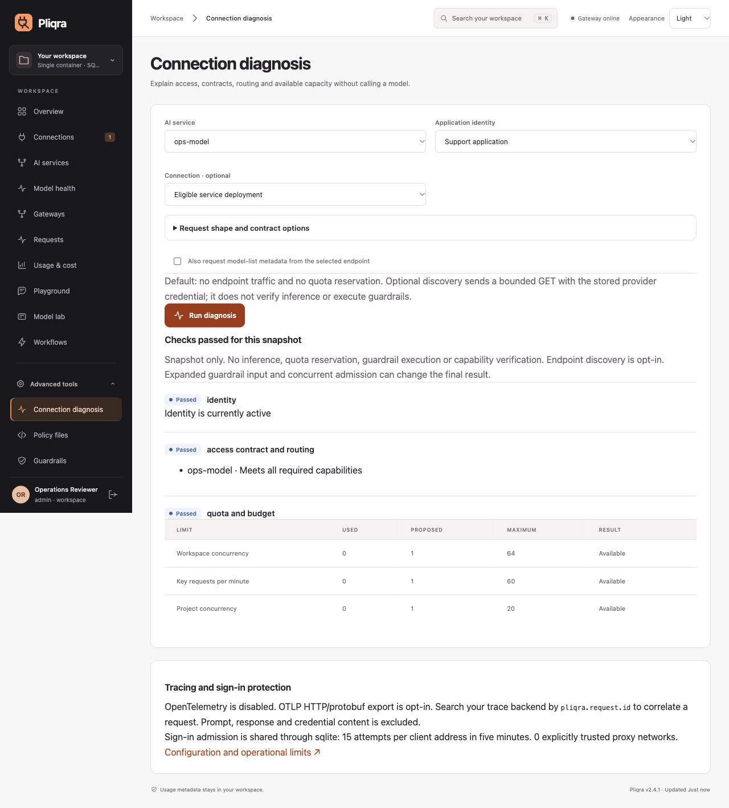

# Operational decision tools

Available in **stable Gateway 2.5.0**, through the prebuilt image and source installation. SDK 1.0.1, Protocol 1.0, inference revision 5 and schema 7 remain unchanged; no client or storage migration is required from 2.4.1.

## Diagnose before making a model call

Open **Advanced tools → Connection diagnosis** as an administrator. Select a service and optionally an application key, assigned gateway or existing binding. Enter the input size, output allowance and capabilities you expect. The tool reuses current identity, access, contract, routing and policy validation and estimates available concurrency, request/token quotas and budget reservations. It does not admit a request, advance round-robin allocation, reserve capacity or execute guardrails.

A failed key, stale binding, disabled service, unavailable deployment or exhausted quota is shown at the relevant phase. No raw key or prompt is needed: select a stored key by ID. Budget estimates use the same conservative worst-price reservation across eligible attempts as inference. Changes made by guardrails and concurrent requests can change the final admission result. A successful snapshot is not a guarantee of later availability.

**Also request model-list metadata** is off by default. Enabling it sends one bounded, five-second GET to an existing configured connection using its stored credential, with no redirects. Results distinguish authentication, base-path, TLS, DNS, connection, timeout, HTTP and discovery-format problems. Discovery is not proof that inference, streaming or tool calling works. A connection-only diagnosis without discovery returns `ready: null`; it confirms configuration rather than reachability. Existing provider endpoints are administrator-controlled destinations, as in normal connection discovery.

```http
POST /api/v1/diagnostics
Content-Type: application/json
X-Pliqra-CSRF: <signed-in administrator's CSRF value>

{"service":"support","key_id":"key_...","requirements":["chat","tools"],"stream":true,"max_tokens":512,"input_chars":2000,"inspect_endpoint":false}
```

`connection_id`, `gateway_id` and `binding_id` are optional. The response contains `ready`, phase-specific `checks`, `model_calls: 0` and `endpoint_checked`. Read-only diagnosis does not create request accounting entries. The POST still requires normal administrator authentication and CSRF protection.



## From behavior failures to application impact

In **Model health**, choose **Application impact** on a schedule. The report links current failed assertions or execution errors to retained, unexpired, currently authorized bindings whose service or active canary candidate references the observed deployment. It shows application/key name, project/team IDs, service, required capabilities, existing contract staleness and alternative deployments eligible under the current declared/verified capabilities, placement and gateway policy.

- **Review required:** a relevant failure has no configuration-eligible alternative.
- **Alternative available:** another deployment meets the configuration requirements; it has not thereby passed the failing behavioral assertion.
- **Requirements not matched:** the observation does not match that binding's declared requirements.

A schedule without completed observations reports `observation_state: not_tested`. Endpoint configuration changes invalidate the current observation. Renew the behavior baseline before interpreting the impact. Disabled/revoked identities are excluded. Unbound applications cannot be discovered from retained bindings. At most 10,000 recent live bindings are scanned; `scan_truncated` explicitly reports an incomplete assessment. Items are paginated with `limit` (1–200) and `offset`.

```http
GET /api/v1/behavior-checks/<schedule-id>/impact?limit=50&offset=0
```

This is advisory. Reading the report never invokes a model, changes capabilities, rewrites contracts, quarantines deployments or switches production traffic. Review the result, then use existing service/gateway publication controls and binding renewal.

## Content-free OpenTelemetry traces

Tracing is disabled by default. The prebuilt and source-built images include the SDK and HTTP/protobuf OTLP exporter; no separate gateway build or tracing server is needed unless tracing is enabled. Configure a collector reachable from the gateway:

```sh
PLIQRA_OTEL_ENABLED=1
OTEL_EXPORTER_OTLP_TRACES_ENDPOINT=https://collector.example.com/v1/traces
OTEL_EXPORTER_OTLP_TRACES_HEADERS=Authorization=Bearer%20COLLECTOR_TOKEN
OTEL_EXPORTER_OTLP_TRACES_TIMEOUT=3
```

Keep collector credentials in deployment Secrets. Standard `OTEL_EXPORTER_OTLP_ENDPOINT` (with `/v1/traces` appended), OTLP headers and certificate options are also supported. This delivery uses **HTTP/protobuf**, not gRPC. Collector HTTP is supported for private-network or loopback receivers; use verified HTTPS across untrusted networks. Configure collector trust with `OTEL_EXPORTER_OTLP_TRACES_CERTIFICATE`; provider trust continues to use `PLIQRA_CA_BUNDLE`. Authentication/header values and the collector address are not returned in the management API.

Incoming valid W3C `traceparent` continues the trace; invalid values establish a fresh trace. Only `traceparent` propagates upstream. Pliqra does not copy baggage, request URLs, query strings, headers, SQL/parameters, prompts, responses, credentials, emails or model names into span attributes. Explicit resources contain the service name/version. Request spans enclose the full ASGI response, including SSE; upstream spans end after stream consumption/close. Child spans measure database operations, Secret resolution, guardrail checks and upstream HTTP. Generic error statuses do not record exception text or stack traces.

`X-Pliqra-Trace-ID` is returned when enabled. Search your trace backend by the `pliqra.request.id` attribute to join a trace to the console request ID. Export runs in a background batch processor with a bounded 2,048-span queue and 128-span batches. Slow or unavailable collectors do not gate model admission; queue overflow may lose traces. Export timeout is constrained to 0.1–10 seconds. Shutdown drains through the SDK's bounded exporter. Traces are operational evidence, not a durable audit ledger. Existing Prometheus metrics and audit/request accounting remain independent.

**Connection diagnosis → Tracing and sign-in protection** shows safe runtime configuration, also available to administrators through `GET /api/v1/diagnostics/runtime`.

## Shared sign-in admission and proxy trust

Local sign-in and initial setup allow **15 attempts per client address per five-minute rolling window**, including successful attempts. The existing database `auth_attempts` ledger now owns admission atomically. PostgreSQL replicas share one limit, retries include `Retry-After`, and restarts do not reset it. Client addresses are HMAC-derived using the workspace key before storage; raw IP addresses are not persisted in this ledger. Local sign-in admission also fails closed if the shared auth-attempt ledger reaches 100,000 rows. Database loss cannot bypass admission.

Direct connections ignore `X-Forwarded-For`. To distinguish clients behind an ingress, explicitly trust **only the immediate proxy networks you operate**:

```sh
PLIQRA_TRUSTED_PROXIES=10.42.4.0/24,2001:db8:42::/64
```

The immediate socket peer must be trusted. A single, bounded `X-Forwarded-For` chain is walked from right to left, removing trusted hops until the first untrusted address. Invalid or duplicate forwarded headers from trusted peers are rejected. The proxy must append the actual peer or replace untrusted input. Do not trust every address, a whole shared cluster, or the public internet. If a load balancer removes the client chain, its address conservatively shares one bucket. This setting controls sign-in buckets only; it does not enable arbitrary forwarded host/scheme trust. Continue setting `PLIQRA_PUBLIC_URL` and secure cookies for HTTPS deployments.

For Helm, use `extraEnv` for proxy/tracing settings and `valueFrom.secretKeyRef` for collector headers; the existing chart supports these without a chart upgrade. Chart 0.3.1 defaults to Gateway 2.2.1: explicitly select Gateway 2.5.0 and its published digest. Restart all replicas with the same proxy policy and workspace encryption key.

## Gateway policy files in Git

Policy files build on existing versioned gateway APIs. They contain names, configuration and explicit workspace-local mappings, not provider credentials. The format is `pliqra/policies/1`. JSON keeps parsing and deployment dependencies small. It intentionally manages only gateway policies; connections, identity providers, Secret values and Fleet pairings retain their existing APIs.

```json
{
  "format": "pliqra/policies/1",
  "source_revision": "aaaaaaaaaaaaaaaaaaaaaaaaaaaaaaaaaaaaaaaa",
  "gateways": [{
    "name": "Support gateway",
    "slug": "support",
    "config": {
      "services": ["support-chat"],
      "max_concurrency": 20,
      "limits": [{"metric":"requests","scope":"gateway","limit":100,"window_seconds":60}]
    }
  }],
  "mapping": {"services":{"support-chat":"svc_REPLACE_WITH_LOCAL_ID"}}
}
```

Map all referenced services, guardrails, projects and teams explicitly. Mappings can differ between environments. A full 40/64-character source revision is optional operator-supplied provenance, not verification of GitHub CI or a signature on the repository. Up to 50 unique gateways and 500 KB of canonical manifest data are accepted. Omitted gateways are never deleted; this is an additive reconciliation workflow.

### Console

Open **Advanced tools → Policy files**. Load an export or example, edit the manifest, then **Plan changes**. Inspect full current/proposed documents and binding impact. Explicitly acknowledge review before **Apply reviewed plan**. Editing the manifest invalidates the local plan. Download manifests for Git and plans for review. The server remains authoritative if the tab is stale.

### CLI and CI

The Python installation/container provides `python -m pliqra policy`. It uses normal administrator sign-in and CSRF, verified remote HTTPS, no automatic apply retry, and no alternative management-key bypass. Set `PLIQRA_ADMIN_EMAIL`; provide the password through a protected `PLIQRA_ADMIN_PASSWORD` environment variable or the interactive prompt. Never commit credentials or place them in arguments. OIDC-only administrators can use the console/API through their existing authenticated session; the CLI currently requires a local administrator account.

```sh
python -m pliqra policy export --url https://gateway.example.com --slug support --output policies.json
python -m pliqra policy plan policies.json --url https://gateway.example.com --revision "$GIT_COMMIT" --output reviewed-plan.json --check
# Review the complete diff and impact; use a protected manual CI approval before apply.
python -m pliqra policy apply reviewed-plan.json --url https://gateway.example.com
python -m pliqra policy plan policies.json --url https://gateway.example.com --check
```

`plan --check` exits 2 when changes exist, 0 when no drift exists and 1 on operational errors; handle exit 2 deliberately in CI. Output files are created with mode 0600 and refuse overwrite. Plans contain no credentials but expose internal policy/topology metadata: treat review artifacts as private. No long-running reconciler or new deployment controller is required.

### API and consistency

- `POST /api/v1/policies/plan` takes a manifest and returns a signed plan, complete diff, current-binding impact, manifest hash and expiry. No managed resources change.
- `POST /api/v1/policies/apply` takes `{"plan":"<signed-token>","approve":true}`. The token is bound to its creating administrator, workspace and restore generation, and expires after ten minutes of database authority time.
- Apply checks every gateway's original fingerprint and desired service/guardrail dependencies again under one transaction **before writing any gateway**. A stale, edited, expired or post-restore plan fails; create and review another plan. A failed write rolls back the whole batch. Concurrent replica applies admit one change; replaying a create/update returns 412. Unchanged policies retain their versions.
- Existing gateway version history and rollback remain available. Apply writes gateway and manifest-revision audit entries. A fresh plan reveals drift from direct console/API edits. Fleet-managed gateways are rejected here; their established second-administrator approval and receipts remain authoritative.

Bindings, grants, quota usage and availability can change after the reviewed snapshot. Neither planning nor applying certifies model quality or reserves inference capacity. Protected Git/CI approval policies are managed by your organization; Pliqra does not claim to enforce repository branch rules.

The tracing API/exporter follows the [OpenTelemetry Python instrumentation](https://opentelemetry.io/docs/languages/python/instrumentation/) and [OTLP HTTP exporter configuration](https://opentelemetry-python.readthedocs.io/en/latest/exporter/otlp/otlp.html).

## Validation

[Source validation record](evidence/operational-tools-source.json): 376 Python tests with real PostgreSQL and all 18 Python/JavaScript/Go HTTP compatibility combinations, 10 console tests, 60 responsive/theme checks, and no known advisories across 47 locked runtime packages. The local Docker build called an actual HTTP model fixture, retained an incoming trace parent and exported content-free spans to an actual OTLP HTTP collector. Atomic two-replica sign-in admission and conditional policy apply, stale/expired plans, rollback, client-address spoofing, fast-clock housekeeping, canary impact and stream lifetimes have executable coverage.

The linked source record is historical pre-release evidence. [2.5.0 release notes](releases/v2.5.0.md) and the published acceptance archive identify the exact-image release, upgrade/recovery, multi-architecture and soak results. Customer-model/vendor acceptance remains deployment-specific.
