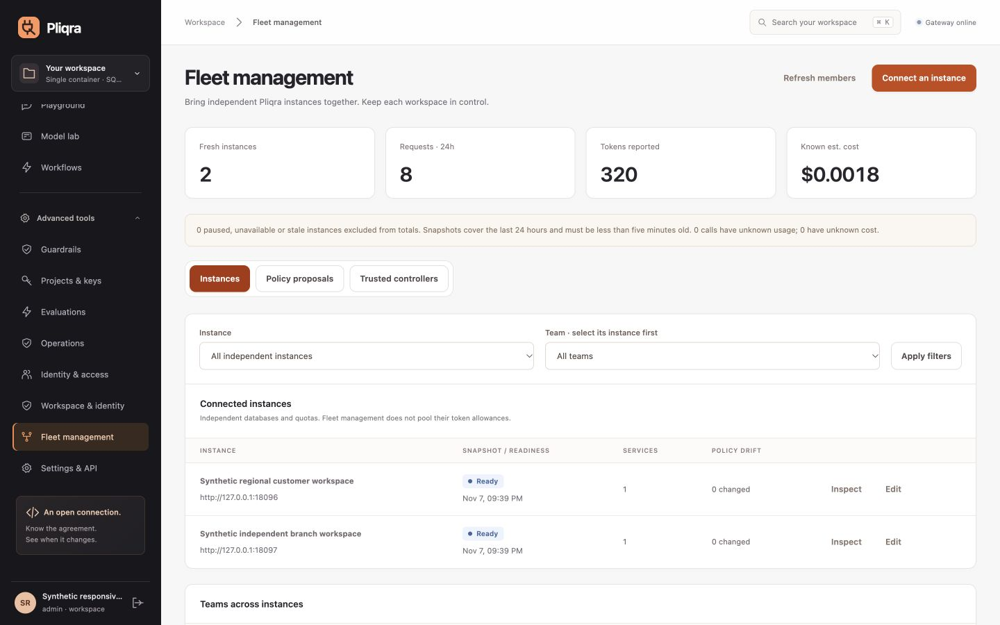

# Responsive console validation — RC4

[← Console tour](CONSOLE.md)

The console keeps navigation, configuration and request details usable in compact laptop windows, tablets and phones. Long pages scroll vertically; information is not forced into one screenful.

## Delivered layout

- **Navigation:** the brand/workspace header and account stay visible around an independently scrolling menu. At 1024 px and below, the menu moves into a dismissible panel with a backdrop, keyboard containment and focus return.
- **Tables:** narrow screens show labelled cards containing every column. Wider tables have their own keyboard-accessible scroll region instead of widening the page.
- **Forms:** filters, actions, tabs, quota/guardrail rows and metric grids adapt to available width. Phone inputs use readable text sizes. Shared action buttons do not accidentally submit their enclosing forms.
- **Dialogs and request details:** the body scrolls within the dynamic viewport height while the header and actions remain reachable. Server errors scroll into view. Escape restores focus after a drawer/menu closes.
- **Navigation continuity:** login preserves the requested page; the skip-to-content link moves focus without changing the current route.

[Full phone dashboard](screenshots/responsive-fleet-mobile.png) · [Phone gateway form](screenshots/responsive-gateway-mobile.png)

## Browser evidence

An isolated local controller, two independent synthetic workspaces and a deterministic model fixture supplied real UI/API data. No existing user workspace or external model was used. Docker was not started for these checks.

| Viewport | Main pages checked |
|---|---:|
| 320 × 568 | 17 |
| 390 × 844 | 17 |
| 768 × 1024 | 17 |
| 844 × 390 | 17 |
| 1280 × 720 | 17 |
| 1440 × 900 | 17 |

All **102** main-page checks passed page-width and clipped-control checks. Additional checks covered:

- 12 workflow, workspace and fleet sub-tabs at the narrowest width.
- 23 form/viewport combinations covering quotas/guardrails, model connections, OIDC/SAML, independent-instance policies, embeddings, speech/transcription and native APIs.
- Three login sizes and three request-drawer sizes.
- The exact 1024/1025 px navigation breakpoint.
- Menu focus containment, forward/backward Tab wrapping, Escape and focus return.
- Applying fleet filters without a page reset; visible server validation errors; login deep links and skip-to-content behavior.

[Machine-readable UI results](evidence/responsive-console.json). These are real interactions and geometry checks in the in-app browser at controlled viewport sizes, rather than physical iOS/Android or cross-engine certification. The viewport tests do not replace assistive-technology acceptance with actual users.

## Regression checklist

When changing shared console components, inspect a populated workspace at the six sizes above. Verify a long menu, a long-name table row, both filter states, an expanded quota/guardrail form, server-side validation, a request drawer and authentication. Check that the document stays within its viewport width, that every input fits its container, and that dialog/drawer actions remain reachable after scrolling. Use keyboard navigation as well as pointer interaction. Preserve table headers and cell labels when adding new tables.

`pliqra/static/responsive.css` owns the shared responsive layer. `layout.js` applies table semantics and manages navigation/focus. Content and authorization remain in their existing UI/API modules.
