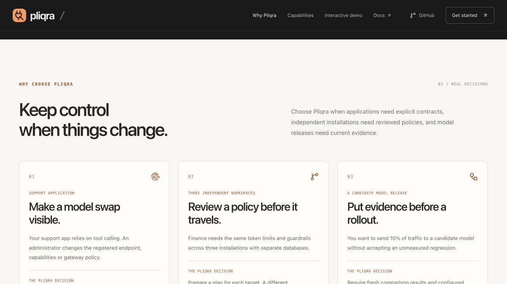

# Product website

**[pliqra.etlabio.com](https://pliqra.etlabio.com)** is the public English product site. [Try the walkthrough](https://pliqra.etlabio.com/#demo) or [open the installation steps](https://pliqra.etlabio.com/#install).

The site explains the need for explicit model contracts and shows the surrounding gateway, guardrail, identity, reporting, workflow, multi-DC and fleet capabilities. Eight interactive scenarios are browser-only teaching simulations. Optional console screenshots come from synthetic workspaces and are labelled accordingly. The site does not collect credentials, make model calls, provide a remote administrator console or include third-party analytics.

## Source and local development

The exact published source is mirrored in [`website/`](../website/README.md), including its dependency lockfile and supplied Vinext/Vite hosting integration. Use Node 24.15+ and npm 12.2+:

```sh
cd website
npm ci
node node_modules/typescript/bin/tsc --noEmit
npm run dev
```

The development address is http://localhost:5173. `npm run build` produces `dist/`. The path-filtered **Product website** GitHub workflow checks a clean dependency installation, TypeScript and the production build. It does not publish automatically. Marketing files are excluded from the gateway Docker build context.

## Publication and domain

The existing Sites project is `appgprj_6aef8da879a08191ae239671218ed40c`, recorded in `website/.openai/hosting.json`. Keep this identity when updating the site. Its public fallback address is [pliqra.turkokesref.chatgpt.site](https://pliqra.turkokesref.chatgpt.site).

For a change, copy the reviewed `website/` source into that project's source checkout, use the Sites source workflow to push the exact state and build its archive, save a version with the returned commit, and deploy that saved version. Verify the deployment before updating the mirror. Publication credentials are temporary and must never be committed or stored in a file. Preserve the public audience and existing project rather than creating another site.

Cloudflare routes the `pliqra` CNAME to `custom-domains.chatgpt.site` with **DNS only**. The `_openai-site-verification.pliqra` and `_cf-custom-hostname.pliqra` TXT records establish the custom hostname. Keep the DNS verification records for this deployment; do not alter unrelated zone records. HTTPS is provided by the hosting service. The initial custom hostname, provider and certificate states were all verified **active**. A newly created name can temporarily remain unavailable through a resolver's cached negative answer even after public DNS resolves it.

Canonical metadata, Open Graph/Twitter image, structured data, sitemap and robots links use `https://pliqra.etlabio.com`. Keep these together if the domain changes. The site currently links gateway **2.1.0**, SDK **0.1.1** and protocol draft **0.1**; change commands, compatibility text and historical evidence references deliberately.

## Validation

The initial publication used source commit `ba49d28ee8b80defe75c2aa4f78c9a18a4190d72`. **Version 2**, published on 10 November 2026, uses `0d1b10c3bdf3fc6b09138b2ef72b5de832ba9e92` in the Sites source repository; `website/` mirrors that exact tracked tree. The opening section now explains three concrete reasons to choose Pliqra: a support application accepting a changed contract, Finance reviewing one policy across three independent installations, and a candidate model meeting evidence gates before a 10% rollout. The ten capability areas and eight demo scenarios remain. TypeScript and the production build passed before publication. [Content and responsive checks](evidence/product-positioning.json) cover eight widths from 320 to 1280 px, including layout boundaries.

[Browser evidence](evidence/product-site-browser.json) records all eight scenarios at **320, 390, 768, 1024, 1280 and 1440 px**, with no document horizontal overflow or clipped demo controls. Additional 720/721 and 900/901 px boundary checks, mobile menu dismissal/focus, tab keyboard navigation, copied SDK examples and console-image loading were checked. The live custom hostname was also opened in the browser. These checks cover the website, not a claim of real customer or external vendor acceptance.



[Mobile screenshot](screenshots/product-site-mobile.png)
